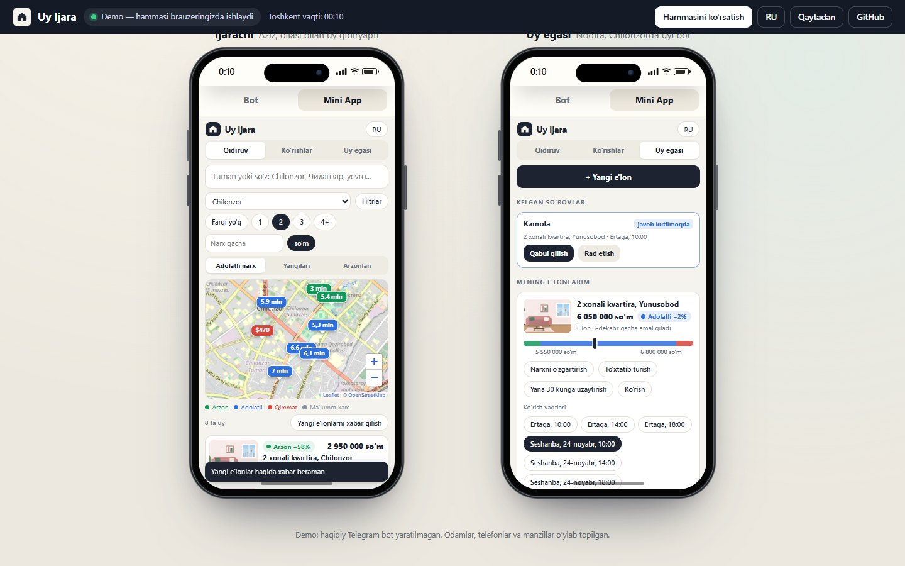
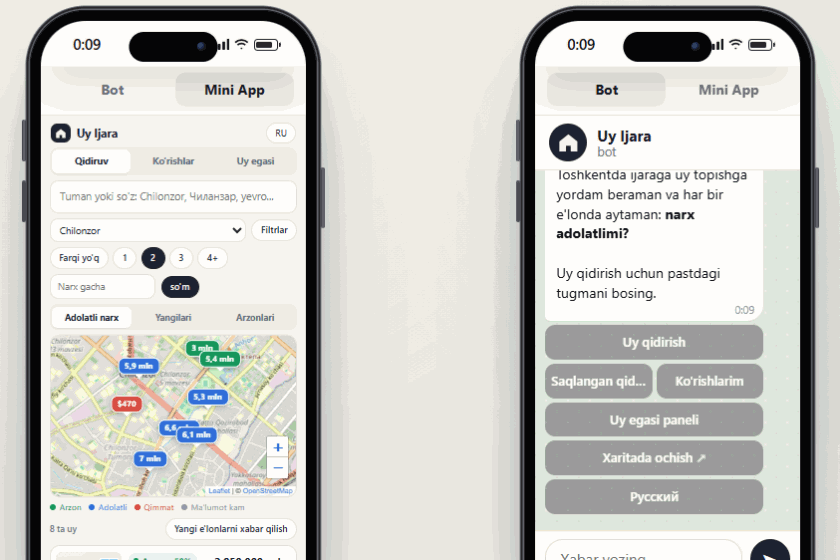
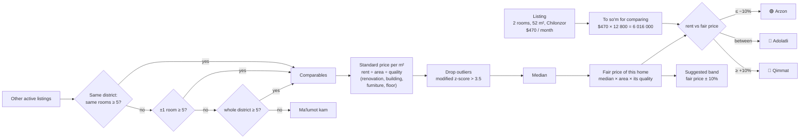

# Uy Ijara

**English** · [O'zbekcha](README.uz.md)

[](https://github.com/xoliddev/uy-ijara/actions/workflows/ci.yml)
[](https://xoliddev.github.io/uy-ijara/)
[](LICENSE)


"Uy ijara" means *a house for rent*. It is a Telegram **bot + Mini App with a map** where tenants in Tashkent find a
flat and landlords post one, and **every listing answers one question: is the rent fair?**

**The wow moment — "Narx adolatlimi?"** Each listing is compared with similar homes in the same district and gets a
verdict: **Arzon** (cheap, green), **Adolatli** (fair, blue) or **Qimmat** (expensive, red), with a percentage and a
plain sentence: *"Chilonzordagi 6 ta o'xshash 2 xonali uy bo'yicha shunday uyning o'rtacha narxi $390. Bu uy 22%
qimmat."* The map pins carry the same colours. While a landlord types a price, a live **"tavsiya etilgan narx"**
(suggested range) shows where it falls — before anything is published.

**[Live demo →](https://xoliddev.github.io/uy-ijara/)** a tenant's phone and a landlord's phone side by side, a
simulated bot and the real Mini App code. Everything runs in your browser.



<p align="center"></p>

## Features

- **Fair-price verdict on every listing.** Median price per m² of comparable listings, adjusted by a few integer
  coefficients (renovation, building type, furniture, first/last floor). The 2–3 biggest factors are shown
  ("Yevro ta'mir +10%, Mebelli +8%"), plus the fair band as a bar with this rent's position on it.
  A rent 35 % or more below its comparables is not shown as a green deal: it is an amber **"Shubhali arzon"**
  (suspiciously cheap) warning, it sorts after the real verdicts, and the listing says not to pay in advance.
- **Robust to junk.** Comparables are the same district and room count, falling back to ±1 room, then the whole
  district — the sentence says which. Fewer than 5 comparables gives "Ma'lumot kam" (not enough data) instead of a
  made-up verdict. Outliers are dropped with the modified z-score, so one fake listing cannot move the median.
- **So'm and dollars.** Rents are listed in so'm or USD and always shown as typed; for comparing, dollars are
  converted at one fixed rate (`USD_RATE`). Money is whole so'm / whole dollars everywhere.
- **Search that forgives how people type.** `Чиланзар`, `Chilanzar`, `chilonzor 2 xonali evro` all work: Latin or
  Cyrillic, Uzbek or Russian, typos (the phonetic folding from day 2). Filters: district, rooms, price up to (so'm
  or $), furnished, pets, "kimga" (family / students / women only / any), minimum area. Sort by fair-price score,
  newest or cheapest.
- **Listing page.** Drawn room pictures (deterministic SVG, keyed by the listing's photo seed — no stock photos) and
  an auto-drawn **floor-plan sketch** from the room count and area; area, floor, building, renovation, amenities,
  "updated 5 min ago", and a district-level area on the map. The exact address is never on the public map.
- **Viewing slots.** The landlord offers times (tomorrow 10:00, 14:00, 18:00...); a tenant picks one; the landlord
  accepts or declines in the bot. **Only after acceptance** do both sides see each other's phone and the exact
  address. A slot can be taken by one tenant only.
- **Saved searches.** "Tell me about new listings like these" fires **exactly once per listing per search**, also
  across restarts.
- **Anti-scam.** Phones hidden until acceptance; duplicate listings refused (same landlord + district + rooms + area,
  or anyone with the same district + area + rent + photos); "Shikoyat" (report) button — three reports hide a
  listing until an admin decides; listings expire after 30 days unless renewed.
- **Landlord panel** in the bot and the Mini App, for their own listings only: post, edit the price (with the live
  band), pause / resume / renew, viewing times, incoming requests.
- **Buttons only.** `/start` is the only command; every screen has "⬅️ Orqaga" (Back). Uzbek by default, Russian
  with one tap.

All people, phone numbers and addresses are **fictional** (`+998 90 000 30 01`...). The 60 seeded listings are
generated from a hash, relative to "today", so the demo works on any date.

## How the fair price is computed



Quality is `100 + coefficients` in whole percent: no renovation −12, euro +10, designer +20; panel −4, monolith +6,
house +3; furnished +8; first floor −5, top floor of a 5+ storey building −4. Everything is integer arithmetic
(`//` and round-half-up division), so the Python server and the JavaScript demo agree to the so'm.

```mermaid
sequenceDiagram
    participant T as Tenant
    participant API as Bot / Mini App API
    participant DB as SQLite (WAL)
    participant L as Landlord
    T->>API: request slot 17 (tomorrow 10:00)
    API->>DB: BEGIN IMMEDIATE; UPDATE slots SET status='held' WHERE id=17 AND status='open'
    DB-->>API: 1 row (or 0: someone was faster)
    API->>DB: INSERT viewing (unique: one live request per slot)
    API-->>L: new request · Accept / Decline
    L->>API: Accept
    API-->>T: exact address + landlord's phone
    API-->>L: tenant's phone
```

The **pure core** (`uyijara/core/`) has no I/O: text folding, money, the fair-price model, listing validation,
search and sorting, viewing slots, the Tashkent calendar and the seed generator. It is ported line by line to
JavaScript (`shared/*.js`), and **shared test vectors** (`shared/test_vectors.json`, made by
`scripts/make_vectors.py`) are checked by both pytest and `node --test` — including every verdict and every
explanation sentence in Uzbek and Russian.

## Run it on Windows in 10 minutes

Install Python 3.12 or newer from [python.org](https://www.python.org/downloads/) (tick **"Add python.exe to PATH"**).

1. **Create a bot.** In Telegram open [@BotFather](https://t.me/BotFather), send `/newbot`, choose a name and a
   username ending in `bot`. Copy the token it gives you.
2. **Get the code.** Download the ZIP and unpack it (or `git clone https://github.com/xoliddev/uy-ijara`).
   Open PowerShell in that folder.
3. **Settings.** Copy the example file and paste your token into `.env`:
   ```powershell
   Copy-Item .env.example .env
   notepad .env
   ```
   To moderate reports, put your Telegram user id in `ADMIN_IDS` (ask [@userinfobot](https://t.me/userinfobot)).
4. **Install and run.**
   ```powershell
   py -m venv .venv
   .venv\Scripts\Activate.ps1
   pip install -r requirements.txt
   python -m uyijara
   ```
   Open your bot in Telegram and press **Start**, then **Uy qidirish**. The fictional demo city is there from the
   first minute (`SEED_DEMO=1`).

### Open the Mini App (the map)

Telegram opens Mini Apps only over HTTPS. On your own computer the easiest free way is a Cloudflare tunnel:

```powershell
winget install --id Cloudflare.cloudflared
cloudflared tunnel --url http://localhost:8080
```

It prints an address like `https://something.trycloudflare.com`. Add `/webapp/` to it, put it in `.env` and restart:

```
WEBAPP_URL=https://something.trycloudflare.com/webapp/
```

### Or with Docker

```powershell
Copy-Item .env.example .env   # then put your token into .env
docker compose up -d --build
```

The container runs as a non-root user on a read-only file system with all capabilities dropped; the database lives
in the `uyijara-data` volume.

## Settings (`.env`)

| Variable | Default | What it does |
|---|---|---|
| `BOT_TOKEN` | — (required) | Token from @BotFather |
| `WEBAPP_URL` | empty | HTTPS address of the Mini App, ending in `/webapp/` |
| `ADMIN_IDS` | empty | Telegram ids of admins (moderate reported listings) |
| `DB_PATH` | `data/uyijara.db` | SQLite file (WAL mode) |
| `SEED_DEMO` | `1` | Fill an empty database with the fictional demo city |
| `USD_RATE` | `12800` | Fixed so'm per dollar, for comparing only |
| `HOST` / `PORT` | `0.0.0.0` / `8080` | Web server for the Mini App and its API |
| `INITDATA_MAX_AGE` | `3600` | Mini App login data older than this (seconds) is refused |
| `RATE_PER_MINUTE` | `30` | Actions per user per minute (bot and API) |
| `SCHEDULER_INTERVAL` | `30` | How often listings expire and saved searches are checked (seconds) |
| `LOG_LEVEL` | `INFO` | Log level |

## Security

- **Mini App login:** every API call carries Telegram `initData`; the server checks its HMAC-SHA256 with the bot
  token and refuses data older than `INITDATA_MAX_AGE` (or from the future).
- **Own listings only:** every landlord query has `landlord_id = <caller>` taken from the verified Telegram id, never
  from the request; another landlord's listing answers "not found" (tested for every route).
- **Contacts after acceptance only:** phones and exact addresses leave the service only for the two people of an
  accepted viewing (and for the landlord's own listings). The public map shows a district-level point.
- **One slot, one tenant:** conditional `UPDATE ... WHERE status = 'open'` inside `BEGIN IMMEDIATE`, plus unique
  partial indexes (one live request per slot, one per tenant per listing); tested with a dozen tenants racing over
  two connections. Duplicate listings are refused by unique indexes too.
- **Strict input validation:** lengths, ranges and enums for every field; whole numbers only (floats and booleans
  refused); request bodies capped at 16 KB; parameterised SQL only.
- **Buttons are not trusted:** callback data is parsed and filtered (known districts, room counts, actions);
  anything else gets "this button is outdated".
- **Per-user rate limits** in the bot and the API; strict CSP, `nosniff` and `no-referrer` headers.
- **Config only from env;** `.env.example` holds placeholders only. Non-root, read-only Docker container.

## Folders

```
uyijara/core/      pure logic, no I/O: fair price, listings, search, slots, money, text, calendar, seed
uyijara/           service (rules and roles), landlord + admin actions, SQLite, initData check, scheduler, API
uyijara/bot/       aiogram 3 handlers and screens (buttons only)
shared/            JS port of the core + locales (uz, ru) + districts and people + shared test vectors
webapp/            Mini App: plain HTML, CSS and JS, Leaflet 1.9.4 vendored, SVG room pictures and floor plans
demo/              GitHub Pages demo: two phones, simulated bot, in-browser backend, guided story
tests/ js-tests/   pytest (core, service, races, bot end-to-end, API) and node --test (parity, demo)
```

## Tests

```powershell
pip install -r requirements-dev.txt
ruff check .
pytest                                  # vectors, fair-price rules, service, races, bot with a mocked Bot API, API
node --test js-tests/*.test.mjs         # JS port on the same vectors; the demo story over 30 days and New Year
npm i --no-save playwright; $env:PW_CHANNEL="chrome"; node scripts/e2e.mjs   # the demo in a real browser
```

## License

[MIT](LICENSE) © 2026 xoliddev. Map data © OpenStreetMap contributors. Leaflet is BSD-2-Clause.
