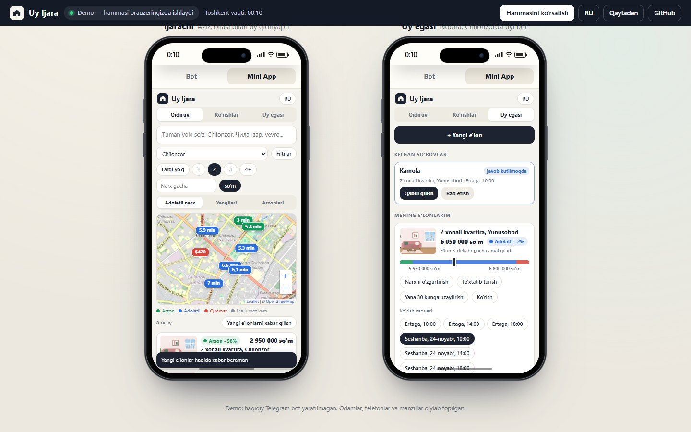
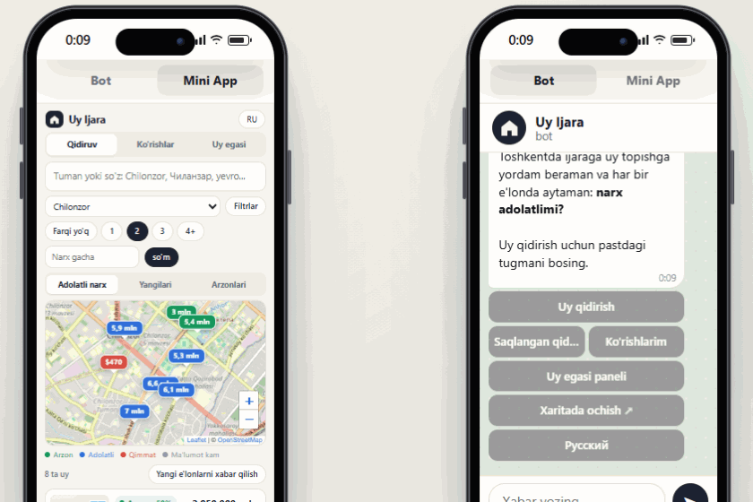
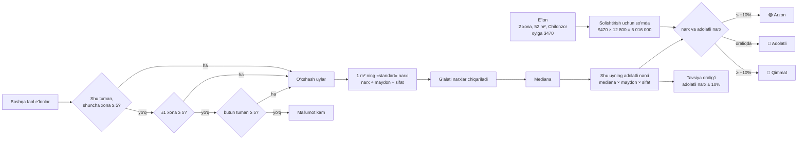

# Uy Ijara

[English](README.md) · **O'zbekcha**

[](https://github.com/xoliddev/uy-ijara/actions/workflows/ci.yml)
[](https://xoliddev.github.io/uy-ijara/)
[](LICENSE)


**Uy Ijara** — Telegram **bot va xaritali Mini App**. Toshkentda ijarachi uy qidiradi, uy egasi e'lon beradi. Har bir
e'lon bitta savolga javob beradi: **narx adolatlimi?**

**Asosiy narsa — «Narx adolatlimi?»** Har bir e'lon shu tumandagi o'xshash uylar bilan solishtiriladi va baho oladi:
**Arzon** (yashil), **Adolatli** (ko'k) yoki **Qimmat** (qizil). Yonida foiz va oddiy gap: *«Chilonzordagi 6 ta
o'xshash 2 xonali uy bo'yicha shunday uyning o'rtacha narxi $390. Bu uy 22% qimmat.»* Xaritadagi pinlar ham shu
rangda. Uy egasi narx yozayotganda **«tavsiya etilgan narx»** oralig'i jonli ko'rinadi — e'lon chiqmasdan oldin.

**[Jonli demo →](https://xoliddev.github.io/uy-ijara/)** chapda ijarachi telefoni, o'ngda uy egasi telefoni. Bot va
Mini App brauzerning o'zida ishlaydi, hech narsa o'rnatish shart emas.



<p align="center"></p>

## Nimalar bor

- **Har bir e'londa narx bahosi.** O'xshash uylarning 1 m² narxi medianasi olinadi va bir nechta butun sonli
  koeffitsiyent bilan to'g'rilanadi: ta'mir, bino turi, mebel, birinchi/oxirgi qavat. Eng katta 2–3 sabab
  ko'rsatiladi («Yevro ta'mir +10%, Mebelli +8%»), adolatli oraliq esa chiziq ko'rinishida, ustida shu uyning joyi.
  Hamma o'xshash uylardan juda arzon bo'lsa — «ehtiyot bo'ling» ogohlantirishi chiqadi.
- **Soxta e'lon bahoni buzmaydi.** Avval shu tuman va shuncha xonali uylar olinadi; kam bo'lsa ±1 xona, keyin butun
  tuman — gapda qaysi biri ekani aytiladi. 5 tadan kam bo'lsa, o'ylab topilgan baho emas, «Ma'lumot kam» chiqadi.
  Juda g'alati narxlar (modified z-score) hisobdan chiqariladi.
- **So'm va dollar.** Narx so'mda yoki dollarda yoziladi va doim shunday ko'rinadi. Solishtirish uchun dollar bitta
  qat'iy kurs bilan so'mga o'giriladi (`USD_RATE`). Pul doim butun son.
- **Qanday yozsangiz ham topadi.** `Чиланзар`, `Chilanzar`, `chilonzor 2 xonali evro` — lotin yoki kirill, xato
  bilan ham. Filtrlar: tuman, xona, narx (so'm yoki $), mebelli, uy hayvoni, «kimga» (oilaga / talabalarga / faqat
  ayollarga / farqi yo'q), maydon. Tartib: adolatli narx, yangilari, arzonlari.
- **E'lon sahifasi.** Xonalar rasmi chizib beriladi (har e'longa o'z uslubi, stok rasm yo'q) va xonalar soni hamda
  maydondan **uy rejasi** avtomatik chiziladi. Maydon, qavat, bino, ta'mir, qulayliklar, «5 daqiqa oldin yangilangan»
  va xaritada tuman darajasidagi taxminiy joy. Aniq manzil ochiq xaritaga hech qachon chiqmaydi.
- **Ko'rishga yozilish.** Uy egasi vaqt taklif qiladi (ertaga 10:00, 14:00, 18:00...), ijarachi bittasini tanlaydi,
  uy egasi botda qabul qiladi yoki rad etadi. **Faqat qabul qilingandan keyin** ikkalasi bir-birining telefonini va
  aniq manzilni ko'radi. Bitta vaqtni faqat bitta odam band qila oladi.
- **Saqlangan qidiruv.** «Shunday yangi e'lon chiqsa xabar ber» — har bir e'lon uchun **faqat bir marta** xabar
  keladi, dastur qayta ishga tushsa ham.
- **Firibgarlikka qarshi.** Telefon qabul qilinguncha yashirin; bir xil e'lonni ikki marta joylab bo'lmaydi;
  «Shikoyat» tugmasi — 3 ta shikoyatdan keyin e'lon admin qaror qilguncha yashiriladi; e'lon 30 kundan keyin
  o'chadi, uzaytirish mumkin.
- **Uy egasi paneli** botda ham, Mini App'da ham, faqat o'z e'lonlari: e'lon berish, narxni o'zgartirish (jonli
  oraliq bilan), to'xtatish / yoqish / uzaytirish, ko'rish vaqtlari, kelgan so'rovlar.
- **Faqat tugmalar.** Yagona buyruq `/start`, har bir ekranda «⬅️ Orqaga». O'zbekcha, bir bosishda ruscha.

Hamma odamlar, telefonlar va manzillar **o'ylab topilgan** (`+998 90 000 30 01`...). 60 ta namunaviy e'lon «bugun»ga
nisbatan yaratiladi, shuning uchun demo istalgan kunda ishlaydi.

## Narx qanday hisoblanadi



Sifat — `100 + koeffitsiyentlar` (butun foiz): ta'mirsiz −12, yevro +10, dizayner +20; panel −4, monolit +6, hovli
+3; mebelli +8; 1-qavat −5, 5+ qavatli binoning oxirgi qavati −4. Hamma hisob butun sonlarda, shuning uchun Python
server va brauzerdagi demo bir so'mgacha bir xil javob beradi.

Hisoblash yadrosi (`uyijara/core/`) JavaScript'ga qatorma-qator ko'chirilgan (`shared/*.js`). Umumiy test
vektorlari (`shared/test_vectors.json`) ikkala tomonda tekshiriladi — har bir baho va o'zbekcha/ruscha har bir
tushuntirish gapi ham.

## Windows'da 10 daqiqada ishga tushirish

[python.org](https://www.python.org/downloads/) dan Python 3.12 yoki yangisini o'rnating (**«Add python.exe to PATH»**
belgisini qo'ying).

1. **Bot yarating.** Telegram'da [@BotFather](https://t.me/BotFather) ni oching, `/newbot` yuboring, nom va `bot`
   bilan tugaydigan username tanlang. Bergan tokenni nusxalang.
2. **Kodni oling.** ZIP'ni yuklab oching (yoki `git clone https://github.com/xoliddev/uy-ijara`). Shu papkada
   PowerShell oching.
3. **Sozlamalar.** Namuna faylni nusxalang va tokenni `.env` ga qo'ying:
   ```powershell
   Copy-Item .env.example .env
   notepad .env
   ```
   Shikoyatlarni ko'rib chiqish uchun `ADMIN_IDS` ga Telegram id'ingizni yozing ([@userinfobot](https://t.me/userinfobot) aytadi).
4. **O'rnating va ishga tushiring.**
   ```powershell
   py -m venv .venv
   .venv\Scripts\Activate.ps1
   pip install -r requirements.txt
   python -m uyijara
   ```
   Botni oching, **Start** ni, keyin **Uy qidirish** ni bosing. Namunaviy shahar birinchi daqiqadan bor
   (`SEED_DEMO=1`).

### Mini App (xarita)

Telegram Mini App'ni faqat HTTPS orqali ochadi. Kompyuteringizda eng oson bepul yo'l — Cloudflare tunnel:

```powershell
winget install --id Cloudflare.cloudflared
cloudflared tunnel --url http://localhost:8080
```

U `https://something.trycloudflare.com` kabi manzil beradi. Oxiriga `/webapp/` qo'shib `.env` ga yozing va qayta
ishga tushiring:

```
WEBAPP_URL=https://something.trycloudflare.com/webapp/
```

### Yoki Docker bilan

```powershell
Copy-Item .env.example .env   # keyin tokenni .env ga yozing
docker compose up -d --build
```

Konteyner root bo'lmagan foydalanuvchi bilan, faqat o'qiladigan fayl tizimida ishlaydi; baza `uyijara-data`
hajmida saqlanadi.

## Sozlamalar (`.env`)

| O'zgaruvchi | Standart | Nima qiladi |
|---|---|---|
| `BOT_TOKEN` | — (majburiy) | @BotFather bergan token |
| `WEBAPP_URL` | bo'sh | Mini App'ning HTTPS manzili, oxiri `/webapp/` |
| `ADMIN_IDS` | bo'sh | Adminlarning Telegram id'lari (shikoyatlarni ko'radi) |
| `DB_PATH` | `data/uyijara.db` | SQLite fayli (WAL) |
| `SEED_DEMO` | `1` | Bo'sh bazaga namunaviy shaharni yozish |
| `USD_RATE` | `12800` | 1 dollar necha so'm (faqat solishtirish uchun) |
| `HOST` / `PORT` | `0.0.0.0` / `8080` | Mini App va API serveri |
| `INITDATA_MAX_AGE` | `3600` | Shundan eski (soniya) Mini App kirish ma'lumoti qabul qilinmaydi |
| `RATE_PER_MINUTE` | `30` | Bir odam uchun daqiqasiga amallar soni |
| `SCHEDULER_INTERVAL` | `30` | Muddat va saqlangan qidiruvlar har necha soniyada tekshiriladi |
| `LOG_LEVEL` | `INFO` | Log darajasi |

## Xavfsizlik

- **Mini App kirishi:** har bir so'rovda Telegram `initData` keladi; server HMAC imzosini bot tokeni bilan tekshiradi
  va eski (yoki «kelajakdan») ma'lumotni rad etadi.
- **Faqat o'z e'lonlari:** uy egasining har bir so'rovida id tekshirilgan Telegram id'dan olinadi, so'rovdan emas;
  boshqa odamning e'loni «topilmadi» deb javob beradi (har bir yo'l uchun test bor).
- **Kontakt faqat qabul qilingandan keyin:** telefon va aniq manzil faqat qabul qilingan ko'rishning ikki tomoniga
  ko'rinadi. Ochiq xaritada faqat tuman darajasidagi taxminiy nuqta.
- **Bitta vaqt — bitta ijarachi:** `BEGIN IMMEDIATE` ichida shartli `UPDATE` va bazadagi noyob indekslar; ikki
  ulanishda o'nlab ijarachi bir vaqtda urinadigan test bor. Takroriy e'lonlarni ham indeks rad etadi.
- **Qat'iy tekshiruv:** har bir maydonning uzunligi, oralig'i va ruxsat etilgan qiymatlari; faqat butun son;
  so'rov hajmi 16 KB gacha; SQL faqat parametrlar bilan.
- **Tugmalarga ishonilmaydi:** callback ma'lumoti tekshiriladi; noma'lum tugma «eskirgan» deb javob oladi.
- **Tezlik cheklovi** botda ham, API'da ham; qat'iy CSP, `nosniff`, `no-referrer`.
- **Sozlamalar faqat env'dan;** `.env.example` da faqat namuna qiymatlar. Docker konteyneri root emas.

## Testlar

```powershell
pip install -r requirements-dev.txt
ruff check .
pytest                                  # vektorlar, narx qoidalari, servis, poyga, bot, API
node --test js-tests/*.test.mjs         # JS yadrosi o'sha vektorlarda; demo 30 kun va Yangi yil orqali
npm i --no-save playwright; $env:PW_CHANNEL="chrome"; node scripts/e2e.mjs   # demo haqiqiy brauzerda
```

## Litsenziya

[MIT](LICENSE) © 2026 xoliddev. Xarita ma'lumotlari © OpenStreetMap hissadorlari. Leaflet — BSD-2-Clause.
